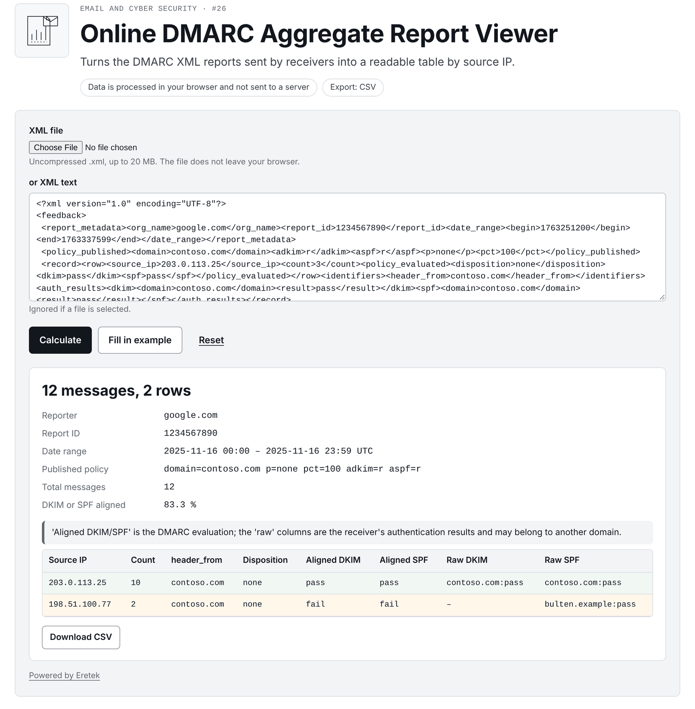

# DMARC Aggregate Report Viewer

Read a DMARC aggregate (rua) XML report in your browser: source IP, message count, disposition, DKIM/SPF alignment and raw results separately. No upload.

## Try it live

- [Türkçe](https://siberguvenlik.eretek.com/araclar/dmarc-rapor-goruntuleyici)
- [English](https://siberguvenlik.eretek.com/en/tools/dmarc-report-viewer)
- [Deutsch](https://siberguvenlik.eretek.com/de/werkzeuge/dmarc-bericht-auswertung)



## What it does

Turns the DMARC XML reports sent by receivers into a readable table by source IP.

Reports arriving at your DMARC `rua` address are compressed XML files showing which IPs send mail as your domain and whether they align with SPF and DKIM. Before moving from p=none to quarantine/reject you need to see in these reports that all legitimate senders are aligned.

## Where it helps

Identify who owns the IPs in unaligned rows: for your own services add them to SPF or enable DKIM; unknown sources are spoofing, which the DMARC policy targets.

Download as CSV to compare several days.

## How to use it

1. Unpack the .gz or .zip attachment on your computer and select the .xml file, or paste the XML text.
2. Press Calculate. The table merges rows with the same source IP and results.

### Fields

| Field | Description |
|---|---|
| XML file | Uncompressed .xml, up to 20 MB. The file does not leave your browser. |
| or XML text | Ignored if a file is selected. |

## Example input

Press **Fill in example** in the tool to load this input.

**or XML text**

```text
<?xml version="1.0" encoding="UTF-8"?>
<feedback>
 <report_metadata><org_name>google.com</org_name><report_id>1234567890</report_id><date_range><begin>1763251200</begin><end>1763337599</end></date_range></report_metadata>
 <policy_published><domain>contoso.com</domain><adkim>r</adkim><aspf>r</aspf><p>none</p><pct>100</pct></policy_published>
 <record><row><source_ip>203.0.113.25</source_ip><count>3</count><policy_evaluated><disposition>none</disposition><dkim>pass</dkim><spf>pass</spf></policy_evaluated></row><identifiers><header_from>contoso.com</header_from></identifiers><auth_results><dkim><domain>contoso.com</domain><result>pass</result></dkim><spf><domain>contoso.com</domain><result>pass</result></spf></auth_results></record>
 <record><row><source_ip>203.0.113.25</source_ip><count>7</count><policy_evaluated><disposition>none</disposition><dkim>pass</dkim><spf>pass</spf></policy_evaluated></row><identifiers><header_from>contoso.com</header_from></identifiers><auth_results><dkim><domain>contoso.com</domain><result>pass</result></dkim><spf><domain>contoso.com</domain><result>pass</result></spf></auth_results></record>
 <record><row><source_ip>198.51.100.77</source_ip><count>2</count><policy_evaluated><disposition>none</disposition><dkim>fail</dkim><spf>fail</spf></policy_evaluated></row><identifiers><header_from>contoso.com</header_from></identifiers><auth_results><spf><domain>bulten.example</domain><result>pass</result></spf></auth_results></record>
</feedback>
```

**Expected result:** 12 messages, 2 rows: 3 + 7 = 10 messages from 203.0.113.25 aligned for DKIM and SPF; 2 messages from 198.51.100.77 not aligned (raw SPF pass for bulten.example).

## Method and assumptions

The XML is read with a safe parser: DOCTYPE and ENTITY declarations are rejected and nothing external is loaded. For each `record` the source IP, count, `policy_evaluated` (disposition, aligned dkim and spf) and `auth_results` (raw DKIM/SPF results and domains) are read.

Rows with the same IP, header_from and results are merged. Alignment rate = messages with DKIM or SPF aligned / total messages.

Policy evaluation and raw authentication results are separate columns: a raw SPF pass is not DMARC-aligned if its domain does not match From.

## Limits and common mistakes

- .gz and .zip archives are not unpacked; unpack them first.
- Forensic (ruf) reports are not supported.
- IP owners (reverse DNS, ASN) are not looked up.

## Run it locally

The tool is plain HTML, CSS and JavaScript with no build step and no dependencies.

```bash
git clone https://github.com/eretek/dmarc-report-viewer.git
cd dmarc-report-viewer
node scripts/serve.js        # or: python3 -m http.server 8080
```

Open <http://127.0.0.1:8080/>. Add `?lang=tr` or `?lang=de` for Turkish or German; without it the page follows the browser language and falls back to English. You can also open `index.html` directly from disk.

Run the tests (Node.js 18 or later):

```bash
node test/run.js    # or: npm test
```

The tests run the tool's own fixtures and the worked examples in all three languages without a browser.

## How it works

All processing happens in your browser. The tool makes no network requests, uses no cookies or browser storage, and does not upload files you select.

No server-side component is needed. The version on the Eretek website renders the same page through a private WordPress plugin; that plugin only produces the page markup and is not part of this repository.

| Path | Purpose |
|---|---|
| `index.html` | Page shell |
| `src/app.js` | Builds the page in Turkish, English or German from `src/data.js` |
| `src/data.js` | Field definitions, examples and all texts in three languages |
| `src/core.js` | Shared runtime: validation, number formats, result rendering, CSV/ICS export |
| `src/tool.js` | The calculation or analysis for this tool |
| `docs/screenshot.png` | Screenshot used in this README |
| `src/lib/xml.js` | Safe minimal XML parser (no DTD, no external entities) |
| `src/tools.css`, `src/page.css` | Styles |
| `test/run.js`, `test/cases.json` | Headless tests |

## License and attribution

This tool is released under the [Eretek Website Attribution License](LICENSE). You may use, modify and redistribute it, including commercially. If you make it available on a website or web application, show a visible, clickable credit linking to https://eretek.com/ on every page where the tool is available, for example:

```html
<a href="https://eretek.com/">Powered by Eretek</a>
```

You may add `rel="nofollow"` to the link. Keep the copyright notice and license text in copies and redistributions.
